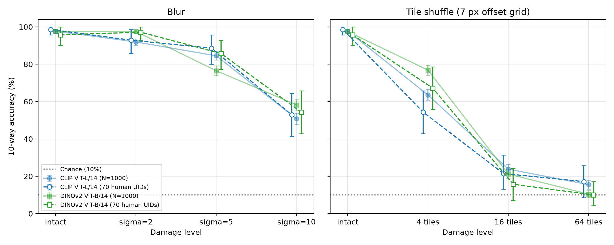

# Blur and Scrambling: People vs. Vision Models

**Authors:** Uriel-Darlin Azemfack-Himele, Fanès Houeha, Halik Mamam, Franck Tchangani  
**Interactive Final Presentation (17 Slides):** [https://yke0let.github.io/blur-scrambling-people-vs-vit/slides.html#1](https://yke0let.github.io/blur-scrambling-people-vs-vit/slides.html#1)  
**Live Psychophysics Platform:** [https://yke0let.github.io/blur-scrambling-people-vs-vit/](https://yke0let.github.io/blur-scrambling-people-vs-vit/)

---

## 1. Research Question

> *Which kinds of image damage—low-pass **Gaussian Blur** vs. **7px-Offset Tile Shuffling**—break Vision Transformers (`CLIP ViT-L/14`, `DINOv2 ViT-B/14`) and human observers together, and which break only one of them?*



---

## 2. Experimental Design & Scientific Invariants

- **Dataset & Stimulus Geometry:**
  - `224 × 224` px grayscale line drawings rendered from *Quick, Draw!* (CC BY 4.0), centered with a `20 px` white margin and `4 px` stroke width (displayed at `384 × 384` px in the web UI for comfortable viewing).
  - **10 Forced-Choice Categories (10-AFC, chance = 10%):** `airplane`, `bicycle`, `car`, `cat`, `chair`, `clock`, `fish`, `house`, `tree`, `umbrella`.
- **ViT Patch Geometry & Offset Scrambling:**
  - Both vision backbones use a `14 × 14` px patch grid (`16 × 16` patches).
  - Tile shuffling shifts the cutting grid by **`+7 px`** (half a patch) and applies a random **derangement** (no tile remains in its original position) so tile boundaries never align with ViT patch boundaries.
- **7 Experimental Conditions:**
  1. `intact` — Uncorrupted baseline drawing
  2. `blur_low` ($\sigma = 2\text{ px}$), `blur_medium` ($\sigma = 5\text{ px}$), `blur_high` ($\sigma = 10\text{ px}$) — Gaussian blur
  3. `shuffle_low` ($2\times 2 = 4$ tiles), `shuffle_medium` ($4\times 4 = 16$ tiles), `shuffle_high` ($8\times 8 = 64$ tiles) — Offset tile scrambling
- **Human Psychophysics Protocol (21 Participants = 3 Groups × 7 Slices):**
  - **21 anonymous participants (`P01`–`P21`)** partitioned into **3 Groups of 7**:
    - **Group 1 (`G1`):** `P01`–`P07` (Slices `S1`–`S7`)
    - **Group 2 (`G2`):** `P08`–`P14` (Slices `S1`–`S7`)
    - **Group 3 (`G3`):** `P15`–`P21` (Slices `S1`–`S7`)
  - Within each group, the 7 participants partition all `490` stimuli (`70` unique test `uid`s × `7` conditions) into 7 disjoint Latin-square slices (`70` trials per participant = `10` per condition, `7` per category). Person $k \in \{1..7\}$ of Groups 1, 2, and 3 evaluates the exact same 70 stimulus images (Slice $k$).
  - **Warm-Up Practice:** 2 intact drawings only (no repetition).
  - **Trial Timing:** `600 ms` central fixation cross $\rightarrow$ **exact `1500 ms` (`1.5s`)** (`performance.now()`) stimulus exposure $\rightarrow$ **`400 ms`** procedural backward visual mask $\rightarrow$ 10-AFC category selection with a **hidden `15000 ms` (`15s`) answer timeout** (any unanswered trial is automatically re-queued to the end of the participant's session).
  - **Strict Anonymity & Automatic Cloud Sync:** No personal names are collected; completed 70-trial sessions are automatically transmitted to the research cloud registry without displaying scores or graphs to the participant.

---

## 3. Final Human & Vision Model Benchmark Results

Linear probes were trained strictly on **intact** training images (`N = 5000`, validated on `N = 1000`) on top of frozen **CLIP ViT-L/14** (`openai/clip-vit-large-patch14`) and **DINOv2 ViT-B/14** (`facebook/dinov2-base`) representations, then evaluated zero-shot across all 7 conditions alongside **21 human observers (`1,470` total trials = 3 independent groups × 7 Latin-square slices)**:

| Condition | Parameter | Humans (`N=21`, `1,470` trials) | CLIP ViT-L/14 (`N=70` UIDs) | CLIP ViT-L/14 (`N=1000`) | DINOv2 ViT-B/14 (`N=70` UIDs) | DINOv2 ViT-B/14 (`N=1000`) |
| :--- | :--- | :---: | :---: | :---: | :---: | :---: |
| `intact` | Baseline | **88.10%** `[83.8, 92.4]` | 98.57% `[95.7, 100.0]` | 97.7% `[96.7, 98.6]` | 95.71% `[90.0, 100.0]` | 97.5% `[96.5, 98.4]` |
| `blur_low` | $\sigma = 2\text{ px}$ | **89.05%** `[84.8, 93.3]` | 92.86% `[85.7, 98.6]` | 91.9% `[90.1, 93.6]` | 97.14% `[92.9, 100.0]` | 97.5% `[96.5, 98.4]` |
| `blur_medium` | $\sigma = 5\text{ px}$ | **82.38%** `[77.1, 87.1]` | 88.57% `[80.0, 95.7]` | 84.5% `[82.3, 86.8]` | 85.71% `[77.1, 92.9]` | 76.5% `[73.9, 79.1]` |
| **`blur_high`** | **$\sigma = 10\text{ px}$** | **82.38%** `[77.1, 87.6]` | 52.86% `[41.4, 64.3]` | 50.8% `[47.6, 53.8]` | 54.29% `[42.9, 65.7]` | 58.2% `[55.1, 61.1]` |
| `shuffle_low` | $2\times 2$ (`4` tiles) | **47.14%** `[40.5, 53.8]` | 54.29% `[42.9, 65.7]` | 63.5% `[60.7, 66.5]` | 67.14% `[55.7, 78.6]` | 76.8% `[74.2, 79.5]` |
| `shuffle_medium` | $4\times 4$ (`16` tiles) | **22.38%** `[16.7, 27.6]` | 21.43% `[12.9, 31.4]` | 23.8% `[21.2, 26.4]` | 15.71% `[7.1, 24.3]` | 21.2% `[18.7, 23.8]` |
| **`shuffle_high`** | **$8\times 8$ (`64` tiles)** | **15.24%** `[10.5, 20.5]` | 17.14% `[8.6, 25.7]` | 15.5% `[13.2, 17.7]` | 10.00% `[4.3, 17.1]` | 10.4% `[8.6, 12.3]` |

*(Brackets indicate 95% confidence intervals computed via 2,000-resample percentile bootstrap. Full report in [`FINAL_EXPERIMENT_RESULTS.md`](./FINAL_EXPERIMENT_RESULTS.md) and interactive slides at [`slides.html`](./slides.html).)*

---

## 4. Repository Structure

```text
├── slides.html                             # Interactive 17-slide final web presentation (HUD, Notes, PDF print)
├── slides.css                              # Monochrome academic design system, SVG animations & @media print 16:9 rules
├── slides.js                               # Verified real-data Chart.js engine, 95% CI error bars & slide router (#1..#17)
├── index.html                              # 5-step academic web psychophysics platform + password-protected Admin Portal
├── human_trials.csv                        # 21-participant Latin-square schedule (1470 rows = 3 groups × 7 × 70 trials)
├── stimuli_human/                          # 490 PNG stimuli (70 test UIDs × 7 conditions, 224×224 grayscale)
├── analyze_results.py                      # Post-collection cloud sync, per-group & global aggregation script
├── New_true_blur_scrambling_people_vs_vit.ipynb # GPU-executed final notebook (stimulus generation, ViT probing, human comparison)
├── FINAL_EXPERIMENT_RESULTS.md             # Consolidated quantitative report (21 humans vs. CLIP ViT-L/14 & DINOv2 ViT-B/14)
├── human_results.csv                       # Pooled human accuracies & 95% bootstrap CIs across all 7 conditions
├── all_human_responses.csv                 # Combined trial-level human responses (1,470 rows across P01–P21)
├── human_results_by_group.csv              # Independent replication accuracies across Groups G1, G2, and G3
├── model_results.csv                       # Model accuracies & 95% bootstrap CIs on the full N=1000 test set
├── model_results_human_subset.csv          # Model accuracies & 95% bootstrap CIs on the 70 human_uids subset
├── comparison_results.csv                  # Side-by-side table comparing N=1000 vs. N=70 human_uids & humans
├── model_predictions.csv                   # Per-image predictions (2 models × 7 conditions × 1000 UIDs)
├── stimuli_manifest.csv                    # Seeds, tile permutations, and ink-tile fractions for all 7000 stimuli
├── main_figure.png                         # Two-panel accuracy plot on the 70 human_uids subset (Blur | Tile Shuffle)
├── comparison_figure.png                   # Two-panel plot overlaying N=1000, N=70 human_uids & human curves
├── human_logs/                             # Directory of individual participant files (responses_P01.csv ... P21.csv)
└── project_outputs/                        # GPU run archive & trained linear probe weights (probe_*.pt)
```

---

## 5. Running the Experiment & Analyzing Human Data

### A. Participant Data Collection
- **Live URL:** `https://yke0let.github.io/blur-scrambling-people-vs-vit/`
- **Direct Slot Link (`P01`–`P21`):** e.g. `https://yke0let.github.io/blur-scrambling-people-vs-vit/?p=P08`
- **Admin / Manager Dashboard:** Click **`Admin / Manager`** in the footer of `index.html` to view live candidate progress (`P01`–`P21`), group comparisons (`Group 1`, `Group 2`, `Group 3`), global human vs. ViT curves, and 1-click CSV exports.

### B. Python Analysis Pipeline
```bash
# Pull cloud-synced participant submissions into human_logs/ and generate all tables & figures:
python3 analyze_results.py --sync-cloud
```

---

## 6. License & Attribution

- Drawing data sourced from the [Google *Quick, Draw!* Dataset](https://github.com/googlecreativelab/quickdraw-dataset) under **CC BY 4.0**.
- Pretrained encoders from OpenAI (`openai/clip-vit-large-patch14`) and Meta AI (`facebook/dinov2-base`) via Hugging Face `transformers`.
